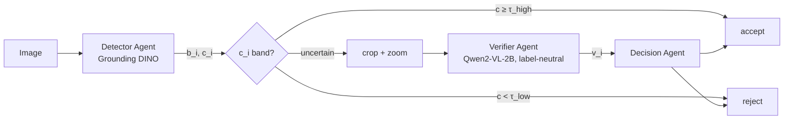

# Detect–Verify–Decide

**A training-free multi-agent pipeline for reducing false positives in object detection.**

A single-pass open-vocabulary detector proposes candidates. An independent, frozen vision–language model re-examines a **crop-and-zoom** of each uncertain candidate without seeing the detector's confidence. A lightweight Decision Agent fuses both signals:

```
accept = (c ≥ τ_high)  ∨  (v = yes ∧ c ≥ τ_low)
```

The project measures how much this lowers the false-positive rate compared with the detector alone, with a Woodpecker-style single-agent self-verifier, and with Visual Contrastive Decoding. It also measures **what that costs** in latency and model calls. All models stay frozen; only the crop margin and two thresholds are chosen, on a held-out split.



## Quick start (Google Colab)

1. Upload this folder to Google Drive as **`MyDrive/detect-verify-decide/`**, or push it to GitHub and set `REPO_URL` in the first cell of each notebook.
2. Open `notebooks/00_setup_and_smoke_test.ipynb` in Colab and set *Runtime → T4 GPU*.
3. Run the notebooks in order: **00 → 01 → 02 → 03 → 05 → 06 → 07 → 08 → 09 → 10**. Notebook 04 (POPE) can run in parallel, and 11 is optional.

Each notebook installs the requirements, mounts Drive and **resumes automatically** after a disconnect. Details: [docs/COLAB_GUIDE.md](docs/COLAB_GUIDE.md).

## Folder structure

```
detect-verify-decide/
├── README.md                     ← you are here
├── requirements.txt              ← Python deps (Colab keeps its own torch)
├── configs/
│   └── default.yaml              ← every experiment setting (models, splits, grids, prompts)
├── src/dvd/                      ← reusable package imported by all notebooks
│   ├── config.py  paths.py  io_utils.py
│   ├── cropping.py               ← crop-and-zoom
│   ├── agents/
│   │   ├── detector.py           ← Detector Agent (Grounding DINO / YOLO-World)
│   │   ├── verifier.py           ← Verifier Agent (frozen Qwen2-VL, P(yes))
│   │   └── decision.py           ← Decision Agent (threshold rule, optional LLM aggregator)
│   ├── pipeline.py               ← cached offline stages + online gated pipeline
│   ├── baselines/
│   │   ├── woodpecker_style.py   ← baseline (ii) single-agent self-verification
│   │   └── vcd.py                ← baseline (iii) Visual Contrastive Decoding
│   ├── metrics.py                ← matching, P/R/F1, breakdown, sweeps, bootstrap, POPE
│   ├── experiments.py            ← methods over identical candidates, selection, cost
│   ├── cost.py  analysis.py  degrade.py  viz.py
│   └── data/                     ← coco.py, pope.py, download.py
├── notebooks/                    ← run on Colab, in order
│   ├── 00_setup_and_smoke_test.ipynb
│   ├── 01_data_preparation.ipynb
│   ├── 02_detector_agent_baseline.ipynb
│   ├── 03_verifier_agent_crop_verification.ipynb
│   ├── 04_verifier_pope_eval.ipynb
│   ├── 05_decision_agent_and_pipeline.ipynb
│   ├── 06_baseline_woodpecker_style.ipynb
│   ├── 07_baseline_vcd.ipynb
│   ├── 08_main_comparison_coco.ipynb
│   ├── 09_cost_analysis.ipynb
│   ├── 10_error_analysis.ipynb
│   └── 11_optional_robustness_monitoring.ipynb
├── docs/                         ← all documentation (see index below)
├── tests/test_core.py            ← CPU-only unit tests (no GPU needed)
├── tools/build_notebooks.py      ← regenerates notebooks/ (overwrites manual edits)
├── data/                         ← dataset zips cache + custom images (git-ignored)
└── results/                      ← caches, tables, figures (git-ignored)
```

## Documentation

| Document | Contents |
|---|---|
| [docs/PROJECT_PLAN.md](docs/PROJECT_PLAN.md) | Step-by-step plan: phases → steps → sub-steps with checkboxes, gates, objective-to-evidence map, risks |
| [docs/ARCHITECTURE.md](docs/ARCHITECTURE.md) | System design, agent interfaces, independence guarantees, data flow, cache files, compute budget |
| [docs/COLAB_GUIDE.md](docs/COLAB_GUIDE.md) | Setting up Drive/GitHub, run order, time estimates, quick vs full runs, troubleshooting |
| [docs/NOTEBOOKS.md](docs/NOTEBOOKS.md) | What each notebook does, reads and writes |
| [docs/SOURCE_CODE.md](docs/SOURCE_CODE.md) | Module-by-module API reference, record formats, how to extend |
| [docs/EVALUATION_PROTOCOL.md](docs/EVALUATION_PROTOCOL.md) | Splits, matching, metric definitions, operating points, breakdown, cost model, fairness rules |
| [docs/DATASETS_AND_BASELINES.md](docs/DATASETS_AND_BASELINES.md) | Datasets, models, baseline implementations and stated deviations, ablations |
| [docs/EXPERIMENT_LOG.md](docs/EXPERIMENT_LOG.md) | Empty results template to fill from `results/` |

## Mapping to the proposal

| Proposal objective | Notebooks |
|---|---|
| 1. Three-agent training-free pipeline | 00, 02, 03, 05 |
| 2. FPR / P / R / F1 vs single-pass detector; verifier on POPE | 02, 04, 05, 08 |
| 3. Role-separation benefit vs Woodpecker-style | 03 (global ablation), 06, 08 |
| 4. Added latency and invocations; accuracy-vs-cost | 09 |
| Error analysis (contribution 4) | 10 |
| Optional monitoring extension | 11 |

## Local development (no GPU)

```bash
pip install numpy pillow pyyaml tqdm
python tests/test_core.py        # metrics, decision rule, cropping, parsers
```

## Status
Code scaffold complete. **No experimental results yet.** All figures cited in the proposal come from the published literature. Results will be added to `docs/EXPERIMENT_LOG.md` once obtained.
