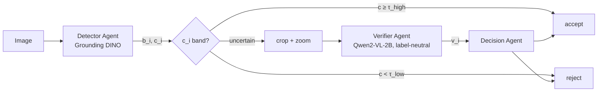

# Detect–Verify–Decide

**A training-free multi-agent pipeline for reducing false positives in object detection.**

A single-pass open-vocabulary detector proposes candidates. An independent, frozen vision–language model re-examines a **crop-and-zoom** of each uncertain candidate without seeing the detector's confidence. A lightweight Decision Agent fuses both signals:

```
accept = (c ≥ τ_high)  ∨  (v = yes ∧ c ≥ τ_low)
```

The project measures how much this lowers the false-positive rate compared with the detector alone, with a Woodpecker-style single-agent self-verifier, and with Visual Contrastive Decoding. It also measures **what that costs** in latency and model calls. All models stay frozen; only the crop margin and two thresholds are chosen, on a held-out split.



## Quick start (Google Colab)

1. Upload this folder to Google Drive as **`MyDrive/detect-verify-decide/`**, or push it to GitHub and set `REPO_URL` in the first cell of each notebook.
2. **Everything in one go (≈2 h target on a T4):** open `notebooks/run_all_fast.ipynb`, set *Runtime → T4 GPU*, *Run all*. It runs every experiment of the proposal in one session on the *fast profile* (150 held-out / 300 test images, plus an optional extended test) and writes `results_fast/SUMMARY.md`. See [docs/FAST_RUN.md](docs/FAST_RUN.md). For the original 500 / 1000-image protocol (≈15–20 GPU hours) set `DVD_CONFIG=full`.

The notebook installs the requirements, mounts Drive and **resumes automatically** after a disconnect. Details: [docs/COLAB_GUIDE.md](docs/COLAB_GUIDE.md). **Kaggle** works too (same notebook, `BRANCH`/`REPO_URL` in the first cell): [docs/KAGGLE_GUIDE.md](docs/KAGGLE_GUIDE.md).

## Folder structure

```
detect-verify-decide/
├── README.md                     ← you are here
├── requirements.txt              ← Python deps (Colab keeps its own torch)
├── configs/
│   ├── default.yaml              ← FAST profile (default): every experiment setting, ~2 h on a T4
│   └── full.yaml                 ← original full protocol (DVD_CONFIG=full), ~15-20 GPU hours
├── src/dvd/                      ← reusable package imported by the notebook
│   ├── config.py  paths.py  io_utils.py
│   ├── cropping.py               ← crop-and-zoom
│   ├── agents/
│   │   ├── detector.py           ← Detector Agent (Grounding DINO / YOLO-World)
│   │   ├── verifier.py           ← Verifier Agent (frozen Qwen2-VL, P(yes))
│   │   └── decision.py           ← Decision Agent (threshold rule, optional LLM aggregator)
│   ├── pipeline.py               ← cached offline stages + online gated pipeline
│   ├── baselines/
│   │   ├── woodpecker_style.py   ← baseline (ii) single-agent self-verification
│   │   └── vcd.py                ← baseline (iii) Visual Contrastive Decoding
│   ├── metrics.py                ← matching, P/R/F1, breakdown, sweeps, bootstrap, POPE
│   ├── experiments.py            ← methods over identical candidates, selection, cost
│   ├── cost.py  analysis.py  degrade.py  viz.py
│   └── data/                     ← coco.py, pope.py, download.py
├── notebooks/                    ← run on Colab
│   └── run_all_fast.ipynb        ← the whole proposal in one session (start here)
├── docs/                         ← all documentation (see index below)
├── tests/test_core.py            ← CPU-only unit tests (no GPU needed)
├── tools/build_notebooks.py      ← regenerates notebooks/run_all_fast.ipynb (overwrites manual edits); run_all_fast cells live in tools/nb_run_all_fast.py
├── data/                         ← dataset zips cache + custom images (git-ignored)
├── results_fast/                 ← caches, tables, figures, SUMMARY.md of the fast profile (git-ignored)
└── results/                      ← same for the full profile (git-ignored)
```

## Documentation

| Document | Contents |
|---|---|
| [docs/PROJECT_PLAN.md](docs/PROJECT_PLAN.md) | Step-by-step plan: phases → steps → sub-steps with checkboxes, gates, objective-to-evidence map, risks |
| [docs/ARCHITECTURE.md](docs/ARCHITECTURE.md) | System design, agent interfaces, independence guarantees, data flow, cache files, compute budget |
| [docs/FAST_RUN.md](docs/FAST_RUN.md) | The one-notebook fast run: what is reduced and why, claim-to-evidence map, knobs, limits |
| [docs/KAGGLE_GUIDE.md](docs/KAGGLE_GUIDE.md) | Running the same notebooks on Kaggle: setup, secrets for a private repo, saving results, resuming |
| [docs/COLAB_GUIDE.md](docs/COLAB_GUIDE.md) | Setting up Drive/GitHub, run order, time estimates, quick vs full runs, troubleshooting |
| [docs/SOURCE_CODE.md](docs/SOURCE_CODE.md) | Module-by-module API reference, record formats, how to extend |
| [docs/EVALUATION_PROTOCOL.md](docs/EVALUATION_PROTOCOL.md) | Splits, matching, metric definitions, operating points, breakdown, cost model, fairness rules |
| [docs/DATASETS_AND_BASELINES.md](docs/DATASETS_AND_BASELINES.md) | Datasets, models, baseline implementations and stated deviations, ablations |
| [docs/EXPERIMENT_LOG.md](docs/EXPERIMENT_LOG.md) | Empty results template to fill from `results/` |

## Mapping to the proposal

All objectives are covered by `notebooks/run_all_fast.ipynb` (sections: detector baseline, verifier + POPE, decision + pipeline, Woodpecker-style and VCD baselines, main comparison, cost, error analysis, robustness, extended test, summary).

## Local development (no GPU)

```bash
pip install numpy pillow pyyaml tqdm
python tests/test_core.py        # metrics, decision rule, cropping, parsers, pipeline events
```

## Status
Code scaffold complete. **No experimental results yet.** All figures cited in the proposal come from the published literature. Results will be added to `docs/EXPERIMENT_LOG.md` once obtained.
