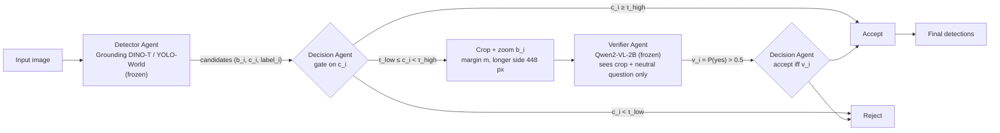

# Architecture

## 1. System overview



The pipeline is **training-free**: no weights are updated. Only three values are chosen, all on the held-out split: the crop margin *m*, τ_low and τ_high.

It is a **single fixed pass** with no iteration, so worst-case latency is bounded by
`t_det + N_band · t_crop`, where `N_band` is the number of candidates in the uncertain band.

## 2. Independence by construction

| Property | How it is enforced | Where |
|---|---|---|
| **Role separation**: the verifier does not decide | The verifier only returns `p_yes`/`verdict`; the separate Decision Agent fuses it with `c` | `agents/verifier.py`, `agents/decision.py` |
| **Evidence separation**: the verifier sees what the detector did not | It sees a crop-and-zoom of the expanded box, upscaled to the VLM's native resolution, never the full scene | `cropping.py`, `make_views(view="crop")` |
| **Confidence blindness** | `c` is never put in the prompt | `VLMVerifier.verify` |
| **Neutral query** | POPE-style "Is there a {label} in the image? Answer yes or no." with no "the detector found…" framing | `configs/default.yaml → verifier.prompt_existence` |
| **Fully label-blind option** | `mode: open`: the VLM names the object and the name is matched to the label afterwards | `VLMVerifier.verify(mode="open")` |

## 3. Agent interfaces

```python
# Detector Agent  (src/dvd/agents/detector.py)
detector.detect(image: PIL.Image) -> {
    "boxes": [[x1, y1, x2, y2], ...],   # pixels, xyxy
    "scores": [c_1, ...],               # detector confidence
    "labels": ["dog", ...],             # COCO class names
    "category_ids": [18, ...],          # COCO ids
    "det_time_s": float, "det_invocations": int, "width": int, "height": int}

# Verifier Agent  (src/dvd/agents/verifier.py)
views = make_views(image, boxes, cfg, view="crop")         # or "full" for the ablation
verifier.verify(views, labels, mode="existence") -> {"p_yes": [...], "verdict": [...], "answers": None | [...]}

# Decision Agent  (src/dvd/agents/decision.py)
agent = RuleDecisionAgent(tau_low, tau_high)
agent.needs_verification(scores) -> bool mask    # the uncertain band
agent.decide(scores, verdicts) -> bool mask       # (c >= τ_high) | (v & c >= τ_low)

# Online pipeline (src/dvd/pipeline.py)
DetectVerifyDecide(detector, verifier, agent, cfg)(image) -> detection record + accept/verified/p_yes + timings
```

### How the verifier scores an answer
The VLM runs one forward pass on `[chat template, image tokens, question]`. P(yes) comes from the logits at the answer position:

```
P(yes) = σ( logsumexp(logits[{Yes, yes, YES}]) − logsumexp(logits[{No, no, NO}]) )
```

This is deterministic, takes one call per crop, and provides a continuous score for AUROC and the margin search. The verdict is `P(yes) > 0.5`.

## 4. Two execution modes

| Mode | Used for | What runs |
|---|---|---|
| **Offline, cached stages** | All experiments | Detector on every image (cache every candidate with c ≥ 0.20). Verifier on **every** candidate (cache P(yes)). The Decision Agent is then evaluated over the whole (τ_low, τ_high) grid from the caches, without re-running any model. |
| **Online, gated** | Deployment, latency validation (NB09), demos | Detector, then the verifier only on the uncertain band, then decide |

The offline mode is valid because the verifier's verdict on a candidate does not depend on the thresholds. Thresholds only decide **which** verdicts are consulted. The cost of a configuration is therefore `N_band(τ_low, τ_high) × t_crop`, and NB09 checks this against a real online run.

## 5. Data flow & cache files

```
COCO val2017 ──NB01──► results/splits.json (held-out 500 / test 1000, seed 42)
             ──NB02──► results/detections/<backend>_<split>.jsonl
                                │
             ┌──NB03───────────┼─────────────► results/verifier/<backend>_<vlm>_crop_existence_m<m>_<split>.jsonl
             │                  │               results/verifier/<backend>_<vlm>_full_existence_<split>.jsonl
             ├──NB06───────────┼─────────────► results/baselines/woodpecker_<backend>_<vlm>_<split>.jsonl
             └──NB07───────────┴─────────────► results/baselines/vcd_<backend>_<vlm>_<split>.jsonl
NB03, NB05 ─────────────────────────────────► results/tuning/selected.json   {crop_margin, tau_low, tau_high, ...}
NB04 (POPE) ────────────────────────────────► results/pope/<vlm>_{plain,vcd}_<setting>.jsonl, pope_results.csv
NB08 ───────────────────────────────────────► results/tables/main_comparison.{csv,md}
NB09 ───────────────────────────────────────► results/cost/*.csv
NB10 ───────────────────────────────────────► results/error_analysis/*.csv
all  ───────────────────────────────────────► results/figures/*.png
```

Each JSONL line holds one image (or one POPE question). On restart, items already in the file are skipped (`io_utils.JsonlCache`). That makes every stage resumable after a Colab disconnect.

**Cache names encode everything that changes the output:** detector backend, VLM, view, mode and margin. Changing any of these in `configs/default.yaml` writes a new cache and never silently reuses an old one.

## 6. How methods are compared

All methods operate on the **same detector candidates** of a split (`experiments.SplitData`). They differ only in how candidates are verified and decided:

| `kind` | Accept rule | Methods |
|---|---|---|
| `none` | `c ≥ τ` | Detector only |
| `rule` | `(c ≥ τ_high) ∨ (v ∧ c ≥ τ_low)` | **DVD (proposed)**; global-view verifier + rule |
| `gate` | `(c ≥ τ) ∧ v` | Crop verifier alone; Woodpecker-style; VCD; plain global yes/no |

Because the models and candidates are identical, any difference is due to pipeline structure, which is the comparison objective 3 asks for.

## 7. Compute budget (single T4, 16 GB)

| Component | Memory | Speed (rough) |
|---|---|---|
| Grounding DINO-T (fp32) | ≈1.5 GB | 4 prompts → ≈0.5–1.5 s/img |
| Qwen2-VL-2B (fp16) | ≈5 GB | ≈0.05–0.15 s per crop (batch 8, ≤448 px) |
| Both loaded together | ≈7 GB peak | — |

The speed figures are planning estimates, not results. Measured values are produced by NB02, NB03 and NB09.

## 8. Design decisions

| Decision | Why |
|---|---|
| Grounding DINO as the detector | Woodpecker uses the same detector, so the comparison is like-for-like (proposal §6.3) |
| ≤2B instruction-tuned VLM | Fits a T4 next to the detector. Modern VLMs are stronger than VQA-era models on position-sensitive tasks. |
| Crop instead of asking "where" | Removes the need for spatial reasoning. The verifier only answers whether the object is present. |
| Single-forward-pass P(yes) | Deterministic, one call per crop, gives a continuous score for tuning |
| Rule-based decision | Cheap, transparent, and sweepable into a PR frontier. The LLM aggregator is an optional alternative. |
| Confidence gating (τ_high) | Confident detections skip the verifier. This bounds cost and protects recall. |
| Resumable JSONL caches | Colab sessions disconnect, and threshold sweeps become free |

## 9. Live progress events (UI hook)

`DetectVerifyDecide.__call__(image, on_event=None)` emits `{"stage", "msg", "progress"}` dictionaries while it runs:
`detector` (one per text prompt) → `gate` → `crop` (one per uncertain candidate) → `verifier` (one per batch, with answers) → `decision` → `done`.

- With `on_event=None` the behaviour and the returned record are identical to the cached offline stages.
- Time spent in the callback is excluded from `det_time_s` and `verify_time_s`, so UI refreshes never inflate the latency numbers.
- The Streamlit app (`app/streamlit_app.py`, see [UI_GUIDE.md](UI_GUIDE.md)) only consumes these events; it contains no pipeline logic.
