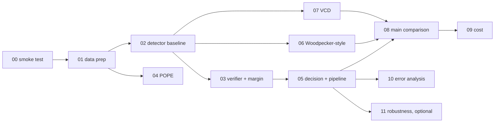

# Project Plan — Detect–Verify–Decide

This plan breaks the proposal into phases, steps and sub-steps. Each step names the file or notebook that implements it, what it produces, and how you know it is done. The phases follow the 16-week work plan in proposal §8.

> **Legend.** `NBxx` = `notebooks/xx_*.ipynb`. `src/dvd/...` = reusable code imported by the notebooks.
> ☐ = to do. Tick the boxes as you go; this file is the project's progress tracker.
>
> **Shortcut for the experiment phases (P3-P5):** `notebooks/run_all_fast.ipynb` runs all of them in one Colab session (fast profile, target ≈2 h, results in `results_fast/`). See [FAST_RUN.md](FAST_RUN.md). The step-by-step notebooks below are the same work split into resumable pieces, and `DVD_CONFIG=full` restores the original protocol.

---

## Overview

| Phase | Weeks | Goal | Main artefacts | Gate |
|---|---|---|---|---|
| P0 Design | 1–2 | Freeze interfaces, crop spec, metrics | `docs/ARCHITECTURE.md`, `docs/EVALUATION_PROTOCOL.md` | Design review |
| P1 Environment & data | 3–4 | GPU environment, models load, COCO + POPE ready, splits frozen | NB00, NB01, `results/splits.json` | Smoke test passes |
| P2 Baselines | 5–6 | Detector-only, Woodpecker-style, VCD running end-to-end | NB02, NB06, NB07 | **Go / no-go** (NB02 §1) |
| P3 Proposed pipeline | 7–9 | Verifier + Decision Agent, tuned crop margin and thresholds | NB03, NB05, `results/tuning/selected.json` | Held-out frontier beats detector-only |
| P4 Experiments | 10–12 | Full runs: COCO test, POPE ×3, optional monitoring subset | NB04, NB08, NB11 | All caches complete |
| P5 Evaluation & analysis | 13 | Cost trade-off, frontier, error analysis | NB09, NB10 | Every objective has a table/figure |
| P6 Report | 14–16 | Write, revise, re-run buffer | `docs/EXPERIMENT_LOG.md`, report | Submission |

Dependency graph of the notebooks:

NB04 (POPE) needs only the verifier, so it can run in parallel with NB02–NB03 in a second Colab session.

---

## Phase P0 — Literature review & pipeline design (weeks 1–2)

### Step 0.1 Finalise the comparison table
- ☐ 0.1.1 Re-read the five papers. For each one, note where in the pipeline it intervenes (decoding, post-hoc, training, debate) and what it verifies (text or boxes).
- ☐ 0.1.2 Copy Table 1 of the proposal into the report draft and check every number against its source (POPE yes-rates, VCD F1, REVERSE 3.05× tokens, MAD-Sherlock $0.24 per sample).
- **Done when:** every number cited in the report has a page or table reference.

### Step 0.2 Define the agent interfaces → `docs/ARCHITECTURE.md` §3
- ☐ 0.2.1 Detector Agent: `detect(image) -> {boxes, scores, labels, category_ids, det_time_s, det_invocations}`.
- ☐ 0.2.2 Verifier Agent: `verify(views, labels) -> {p_yes, verdict}`. It is never given the detector confidence.
- ☐ 0.2.3 Decision Agent: `decide(scores, verdicts) -> accept` with `accept = (c ≥ τ_high) ∨ (v ∧ c ≥ τ_low)`.
- ☐ 0.2.4 Gating: only candidates in the band `τ_low ≤ c < τ_high` are sent to the verifier.
- **Done when:** the interfaces in `src/dvd/agents/*.py` match the document.

### Step 0.3 Crop-and-zoom specification → `src/dvd/cropping.py`
- ☐ 0.3.1 Expand each box by margin *m* × (box width/height) on every side, clipped to the image.
- ☐ 0.3.2 Upscale the crop so its longer side is 448 px (bicubic) and both sides are at least 28 px (the Qwen2-VL patch size).
- ☐ 0.3.3 Candidate margins: `{0, 0.10, 0.15, 0.25, 0.40}`. Tune on held-out only (Step 3.1).

### Step 0.4 Freeze the evaluation protocol → `docs/EVALUATION_PROTOCOL.md`
- ☐ 0.4.1 Matching: IoU ≥ 0.5, same class, greedy by score, crowd regions ignored.
- ☐ 0.4.2 Definitions: precision, recall, F1, FP/image, FP reduction, and the decision breakdown (correct rejection, omission, over-rejection).
- ☐ 0.4.3 Operating-point selection: best-F1 and matched-recall, both chosen on held-out and applied unchanged to test.
- ☐ 0.4.4 Cost: latency per image and model invocations per image.

---

## Phase P1 — Environment & dataset preparation (weeks 3–4)

### Step 1.1 Colab environment → `NB00`, `docs/COLAB_GUIDE.md`
- ☐ 1.1.1 Upload the repo to `MyDrive/detect-verify-decide` (or push it to GitHub and set `REPO_URL`).
- ☐ 1.1.2 Runtime → Change runtime type → **T4 GPU**.
- ☐ 1.1.3 Run NB00. The bootstrap mounts Drive, installs `requirements.txt` and loads the config.
- ☐ 1.1.4 Check that the detector finds the cats, that the verifier gives P(yes) below 0.5 for absent objects, and that peak GPU memory is well under 15 GB.
- **Done when:** every item on the NB00 checklist is ticked.

### Step 1.2 Integrate the detector → `src/dvd/agents/detector.py`
- ☐ 1.2.1 Grounding DINO-T (HF `IDEA-Research/grounding-dino-tiny`). The 80 COCO classes are split into 4 prompts of 20 names.
- ☐ 1.2.2 Map returned phrases to COCO classes (exact, then substring, then fuzzy match), then apply class-wise NMS at IoU 0.7.
- ☐ 1.2.3 Optional: switch to the YOLO-World backend (`detector.backend: yolo_world`).

### Step 1.3 Integrate the VLM → `src/dvd/agents/verifier.py`
- ☐ 1.3.1 Qwen2-VL-2B-Instruct (bf16 or fp16) with left padding for batched inference.
- ☐ 1.3.2 Compute P(yes) from one forward pass: the softmax of the "Yes"/"yes" token group against the "No"/"no" group.

### Step 1.4 COCO val2017 → `NB01`
- ☐ 1.4.1 Download the images (≈780 MB) and annotations (≈240 MB). The zips are cached on Drive and extracted to `/content/data`.
- ☐ 1.4.2 Create the seeded split: **500 held-out** (tuning only) and **1000 test** (set `test_size: null` to use all 4500). Saved to `results/splits.json` and never regenerated.
- ☐ 1.4.3 Record split statistics (instances per image, empty images).

### Step 1.5 POPE question sets → `NB01` §3
- ☐ 1.5.1 Load `lmms-lab/POPE`: random, popular and adversarial settings, 3000 questions each. If the Hugging Face copy is unavailable, the code falls back to the GitHub files plus COCO val2014 images.
- ☐ 1.5.2 Verify that each setting is 50 % yes / 50 % no.

### Step 1.6 Co-occurrence statistics → `NB01` §4
- ☐ 1.6.1 For each class, store its 10 most frequently co-occurring classes in `results/data/cooccurrence_top10.json`. This is used to flag hallucination-style false positives in Step 5.3.

---

## Phase P2 — Baseline implementation (weeks 5–6)

### Step 2.1 Baseline (i): detector only → `NB02`
- ☐ 2.1.1 **Go / no-go checkpoint** on 50 held-out images. Expect best-F1 precision and recall both above 0.3. If either is lower, debug the label mapping or thresholds before going further.
- ☐ 2.1.2 Cache every candidate with c ≥ 0.20 for held-out and test (`results/detections/`).
- ☐ 2.1.3 Sweep τ. Pick τ\* (best F1) on held-out and apply it to test.
- ☐ 2.1.4 Sanity check: COCO mAP from `pycocotools` should be clearly non-trivial. It is a lower bound because candidates below 0.20 are discarded.
- ☐ 2.1.5 Record detector latency and invocations per image.

### Step 2.2 Baseline (ii): Woodpecker-style single agent → `NB06`, `src/dvd/baselines/woodpecker_style.py`
- ☐ 2.2.1 Prompt the same VLM with the full image and a numbered list of the top-30 candidates (boxes on a 0–1000 scale). It answers yes/no per item.
- ☐ 2.2.2 Parse the answers and log the parse rate. Unparsed items keep the detector's claim; unlisted items are rejected.
- ☐ 2.2.3 Sweep τ over the verdicts (no confidence fusion) and select on held-out.
- ☐ 2.2.4 Document the deviation from the official code (GPT-3.5 + BLIP-2) in `docs/DATASETS_AND_BASELINES.md`.

### Step 2.3 Baseline (iii): VCD → `NB07`, `src/dvd/baselines/vcd.py`
- ☐ 2.3.1 Diffusion noise using the official schedule (1000 steps, noise step 500) in CLIP-normalised space.
- ☐ 2.3.2 Contrastive yes/no with α = 1 and β = 0.1 (plausibility cut-off).
- ☐ 2.3.3 Run one question per (image, label) on the full image. The plain answer comes from the same passes at no extra cost.
- ☐ 2.3.4 Check how the proposal's "γ = 0.1" maps onto the VCD paper's parameters and record the mapping in the report.

---

## Phase P3 — Proposed pipeline implementation (weeks 7–9)

### Step 3.1 Tune the crop margin → `NB03` §1
- ☐ 3.1.1 Run the verifier on 200 held-out images for each margin.
- ☐ 3.1.2 Criterion: AUROC of P(yes) for separating true from false candidates. Also log the FP-rejection rate and the TP over-rejection rate.
- ☐ 3.1.3 The best margin is written to `results/tuning/selected.json`, and every later notebook uses it.

### Step 3.2 Verify all candidates → `NB03` §2–3
- ☐ 3.2.1 Run the crop verifier on held-out and test.
- ☐ 3.2.2 Ablation: run the same verifier with the full image as its view (global evidence).
- ☐ 3.2.3 Optional: open-answer label-blind mode on the tuning subset.
- ☐ 3.2.4 Diagnostics: P(yes) histograms for TP vs FP, AUROC, yes-rate, seconds per crop.

### Step 3.3 Decision Agent → `NB05`, `src/dvd/agents/decision.py`
- ☐ 3.3.1 Sweep the (τ_low, τ_high) grid on held-out. Everything is computed offline from the caches, so no model runs again.
- ☐ 3.3.2 Plot the F1 heat-map and the precision–recall frontier.
- ☐ 3.3.3 Select the best-F1 and matched-recall operating points and save them to `selected.json`.
- ☐ 3.3.4 Optional: compare an LLM aggregator against the rule on 100 held-out images.
- ☐ 3.3.5 Demo the online gated pipeline on a few test images.
- **Gate:** on held-out, the pipeline's frontier should dominate detector-only at matched recall. If it does not, revisit the margin, the prompt wording, or a smaller τ_high grid before running the remaining experiments.

---

## Phase P4 — Experiments (weeks 10–12)

### Step 4.1 Verifier on POPE → `NB04`
- ☐ 4.1.1 Plain decoding on random, popular and adversarial (accuracy, precision, recall, F1, yes-rate).
- ☐ 4.1.2 VCD decoding on the same questions.
- ☐ 4.1.3 Report the yes-rate explicitly as the over-assertion diagnostic.

### Step 4.2 Main COCO comparison → `NB08`
- ☐ 4.2.1 Make sure the caches are complete for: detector-only, the proposed pipeline, crop verifier alone, global verifier with the rule, Woodpecker-style, VCD, and plain global yes/no.
- ☐ 4.2.2 Select operating points on held-out (best-F1 and matched-recall) and evaluate on test with 1000-sample bootstrap CIs.
- ☐ 4.2.3 Save `results/tables/main_comparison.{csv,md}` and the PR-frontier figure.

### Step 4.3 Optional monitoring extension → `NB11`
- ☐ 4.3.1 Run 200 test images under four degradations: low light, motion blur, low resolution and JPEG.
- ☐ 4.3.2 Compare detector-only and the pipeline using the thresholds tuned on clean held-out data, to measure transfer.
- ☐ 4.3.3 Qualitative run on your own CCTV or traffic frames (`data/custom_images/`).

### Step 4.4 Demo UI (optional) → `NB12`, `app/streamlit_app.py`, [UI_GUIDE.md](UI_GUIDE.md)
- ☐ 4.4.1 Run NB12 on Colab and confirm the five agent cards, the progress percentage and the log update live with the real models.
- ☐ 4.4.2 Screenshot a run for the report or the presentation. The UI is a demo, not a source of reported numbers.

---

## Phase P5 — Evaluation & analysis (week 13)

### Step 5.1 Cost trade-off → `NB09`
- ☐ 5.1.1 For every (τ_low, τ_high) configuration: added latency, verifier calls, FP reduction and F1.
- ☐ 5.1.2 Method-level cost at each method's operating point: FPS, and FP reduction per added second.
- ☐ 5.1.3 Validate the cost model: compare an online gated run on 100 images against the estimate.

### Step 5.2 Precision–recall frontier → `NB05` §5, `NB08`
- ☐ 5.2.1 Overlay the frontiers of all methods and mark the selected points.

### Step 5.3 Error analysis → `NB10`
- ☐ 5.3.1 Per category: FP-removal and over-rejection rates.
- ☐ 5.3.2 By object size, detector-confidence bin, brightness tercile (low-light proxy) and co-occurrence FP.
- ☐ 5.3.3 Galleries of correct rejections, omissions and over-rejections.
- ☐ 5.3.4 Write down where verification helps, where it only adds cost, and where it hurts recall.

---

## Phase P6 — Report writing & buffer (weeks 14–16)

- ☐ 6.1 Fill in `docs/EXPERIMENT_LOG.md` from the CSVs in `results/`. Copy numbers from the files, never by hand from memory.
- ☐ 6.2 Results section: one table or figure per objective (see the mapping below).
- ☐ 6.3 Limitations: only a 1000-image test subset, Woodpecker and VCD are re-implementations, single verifier model.
- ☐ 6.4 Re-run buffer: delete one cache, re-run its notebook, and confirm the numbers reproduce (the seeds are fixed).
- ☐ 6.5 Acknowledge every checkpoint, dataset and codebase used (see `docs/DATASETS_AND_BASELINES.md`).

---

## Objective → evidence mapping

| Proposal objective | Evidence | Produced by |
|---|---|---|
| 1. Design the training-free three-agent pipeline | Working code, architecture figure, online demo | `src/dvd/`, NB00, NB05 §7 |
| 2. FPR, P, R, F1 vs single-pass detector; verifier on POPE | `main_comparison.md`, `pope_results.csv` | NB08, NB04 |
| 3. Benefit of role separation vs Woodpecker-style | Rows "Woodpecker-style", "crop verifier alone", "global verifier + rule" | NB06, NB03 §3, NB08 |
| 4. Added latency and invocations; accuracy-vs-cost | `pipeline_config_costs_test.csv`, `online_vs_estimated.csv`, cost figure | NB09 |
| Contribution 4: error analysis | `results/error_analysis/*.csv`, galleries | NB10 |

## Risk register

| Risk | Mitigation |
|---|---|
| Colab disconnects mid-run | Every stage writes JSONL per image and resumes automatically |
| T4 runs out of memory | Grounding DINO-T + 2B VLM ≈ 6–7 GB. Lower `verifier.batch_size` if needed. Never load two VLMs. |
| Too slow for all 5000 images | Default test split is 1000 images. Scale up with `coco.test_size` once everything works. |
| Verifier over-rejects true detections | Confident detections bypass it via τ_high. Over-rejection is reported explicitly. |
| Woodpecker-style output does not parse | Parse rate is logged. Unparsed items keep the detector's claim. |
| HF POPE dataset unavailable | Automatic fallback to the GitHub question files plus per-image COCO val2014 downloads |
| `transformers` API drift | Pinned to `>=4.49,<5`. Detector post-processing handles both threshold argument names. |
